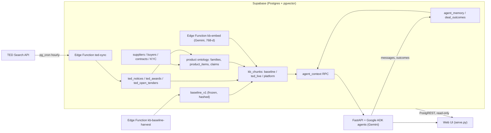

# SalesPatriot Agent

**Buyer and supplier AI agents that find, vet and negotiate Europe's weapons and ammunition supply deals,
grounded in EU public procurement data.** Built for the *Build the Arsenal: SalesPatriot Europe Challenge*
(Warsaw, 30 October 2026).

The system reads every tender on TED (Tenders Electronic Daily) in four product classes: ammunition, firearms,
parts of firearms and ammunition, and miscellaneous weapons. It covers supplies only, across all of Europe.
Every tender, awarded lot and catalogue line is sorted into one shared product ontology. Ten years of
procurement history become evidence an agent can cite, and each company gets an agent that works inside a
mandate. A supplier agent assesses a tender. A buyer agent finds proven suppliers, weighs their KYC and
14 per-deal checks, and benchmarks their quotes against real awarded prices.

## Why it works

- **History is frozen; only the platform learns.** The knowledge base has three layers.
  `baseline_v1` holds 17,025 TED notices, linked into 10,222 procedures from tender to outcome. It is frozen
  with a SHA-256 content manifest, and guard triggers block any change to it.
  `ted_live` is synced every hour.
  `platform` holds our own deals and is the only layer that writes agent memory.
  Statistics are blended as `w = n_platform / (n_platform + 10)`: history is the prior, and each closed deal on
  the platform moves the estimate. Every piece of evidence names its layer.
- **One context call per purpose, not free-form RAG.** Agents never query tables. They call
  `agent_context(role, purpose, subject)` with one of five purposes and get the same JSON shape back every time:
  facts, candidates, evidence, price anchors, regulatory profile, memory, priors and warnings.
  The logic lives in SQL, so the backend stays thin and every agent sees the same facts.
- **Every number has a ref and an n.** Each evidence item and price anchor has a `ref` (for example
  `ted:750233-2026`), and priors state their sample size. A unit price without clean data stays null with a
  warning instead of a guess. Before a message is stored, the orchestrator drops any ref the agent cites that
  appears neither in its context pack nor in its tool results, and records it in `payload.dropped_refs`.
- **The model recommends; the mandate decides.** Gemini drafts and recommends. Python policy gates decide what
  happens. An `accept` above the autonomous limit becomes `escalate`. A price above the ceiling becomes a
  `counter` at the ceiling. Unknown KYC escalates. The agent's company id is bound in a closure by the backend,
  so the model never chooses whose data it reads.
- **Strict unit prices.** A price benchmark uses only clean data points: pieces, quantity above 1, a single lot
  with a stated quantity, and one result notice. When the tender names a calibre, it compares only with the
  same family, calibre and country, and never mixes calibres.
- **One ontology for supply and demand.** Tenders, awarded lots and supplier catalogue lines go through the same
  classifier into the same 28 product families when they are stored, not at query time. A buyer asking for
  "9 mm Parabellum" and a supplier selling "9×19 Luger" end up on the same family and calibre (next section).

## Architecture



## How it works

### 1. Data ingest
- [`supabase/functions/ted-sync/sync.ts`](supabase/functions/ted-sync/sync.ts) runs every hour at minute 17
  (pg_cron → Edge Function). It re-reads the last two days and upserts by publication number. As of
  30 October 2026 the public [status endpoint](https://aodxjmjnsqvadxcrepfr.supabase.co/functions/v1/ted-sync)
  reports 4,840 notices, 1,036 award rows (one per notice and winner) and 33 open tenders.
- Company profiles come from [`ted_company_profiles.py`](ted_company_profiles.py) and
  [`ted_supplier_contracts.py`](ted_supplier_contracts.py) (lot-level awards parsed from the eForms XML).
  [`translate_data.py`](translate_data.py) translates them to English and [`supabase_sync.py`](supabase_sync.py)
  pushes them to Supabase.
- Scope, filters and API limits: [`knowledge_base/21-focus-scope.md`](knowledge_base/21-focus-scope.md),
  [`20-ted-api-reference.md`](knowledge_base/20-ted-api-reference.md),
  [`25-supabase-ted-sync.md`](knowledge_base/25-supabase-ted-sync.md).

### 2. Product families: how we split the market
**The problem.** TED says *what* was bought only through CPV codes and free text in 24 languages. In our scope
about 41% of notices stop at a class-level code such as `35330000` "Ammunition", about half of the lot titles
name no product ("Los 1 2023", "Časť 5"), and one calibre comes in many spellings ("9×19 mm", "9 mm Luger",
"Parabellum"). Matching raw CPV codes or raw text would miss most deals. So every item gets one product family
and a typed set of attributes, by the same rules on the supply side and the demand side.

**Two levels, then attributes.** The level 1 class is the CPV class as TED publishes it. The level 2 family is
our own code. Everything finer is an attribute, never a deeper level. Tenders use 74 different calibres, so
calibre is a field, not a family.

```
CPV class                 product family                  typed attributes (schema per family)
35330000 ammunition  ──►  ammunition.small_calibre  ──►  calibre=9x19, round_type=ball, lead_free=true …
35320000 firearms    ──►  firearms.handguns         ──►  calibre=9x19, action=semi_automatic, magazine_capacity=17 …
```

| Class (CPV) | Families |
|---|---|
| `ammunition` (35330000), 13 | `small_calibre` · `shotgun` · `training_blank` · `less_lethal` · `medium_calibre` · `grenade_40mm` · `hand_grenade` · `mortar` · `artillery` · `heavy_ordnance` · `pyrotechnics` · `explosives_demolition` · `components` |
| `firearms` (35320000), 9 | `handguns` · `submachine_guns` · `rifles_carbines` · `precision_rifles` · `machine_guns` · `shotguns` · `launchers` · `mortars` · `artillery_systems` |
| `parts` (35340000), 4 | `small_arms_parts` · `accessories_tools` · `sights_optics` · `heavy_weapon_parts` |
| `misc_weapons` (35310000), 2 | `bladed` · `other_weapons` |
| `out_of_scope`, 7 | `protective_equipment` · `law_enforcement_equipment` · `optronics` · `uniforms_clothing` · `ranges_targets` · `services` · `noise` |

The out-of-scope families catch what hides under our CPV codes but is not a weapon: body armour, uniforms,
medals, fire-hose nozzles filed as "lances", gunmetal plumbing fittings. They are classified and stored, but
never matched.

**How we decided the split.** A family exists only if both hold:
1. **Enough data:** roughly 30 notices or lots a year on TED, or a clear platform need.
2. **It is really different from its neighbours:** a different attribute schema, a different regulatory or
   transport regime (Military List category, ADR class, Firearms Directive), or different suppliers and buyers.

We never split by an attribute value (calibre, brand, colour). Family ids are stable (`<class>.<family>`); a
family is deprecated, never renamed. Boundary cases are written down as rules, for example:
- 12.7 mm and 14.5 mm cartridges → `small_calibre`: same regime as rifle rounds (EU Military List ML3.a,
  NATO FSC 1305, ADR "small arms").
- 40×46 / 40×53 grenades → `grenade_40mm`, but 40 mm L70 cannon rounds → `medium_calibre`.
- Impact, irritant and flash-bang rounds in 40 mm, 37 mm or 12 gauge → `less_lethal`: the effect decides.
- A thermal sight on the weapon → `parts.sights_optics`; hand-held thermal binoculars → `out_of_scope.optronics`:
  the mounting decides.
- Practice rounds stay in their calibre's family with `round_type = practice`.

All rules: [`knowledge_base/25-product-families.md`](knowledge_base/25-product-families.md).

**What a family carries.** One entry in [`data/families.yaml`](data/families.yaml) (shortened):

```yaml
- id: ammunition.small_calibre
  includes: [pistol cartridges, rifle cartridges, machine-gun belts, match and subsonic ammunition]
  excludes: [blanks and marking rounds (training_blank), shotgun cartridges (shotgun), loose bullets cases primers powder (components)]
  attributes:
    calibre: {required: true, match_key: true}
    round_type: {match_key: true}
    bullet_weight_g: {}
    lead_free: {}
  cpv: {candidate: ["35331500", "35331000", "35331100"]}
  keywords: ["n[aá]boj", "patron", "cartridge", "cartouche", "cartucho", "amunicj", "lőszer", "патрон"]
```

- **Attributes** come from one dictionary of 59 keys; each key means the same thing everywhere. `match_key`
  attributes are hard filters when both sides state them. `required` is enforced only on platform listings,
  never on text extracted from TED.
- **Calibres** are normalised to 57 canonical codes (`5.56x45`, `7.62x54R`, `155mm`, `12ga`, `.22LR`):
  `product_normalise_calibre('7,62mm x 51')` returns `7.62x51`, and `'9 mm Parabellum'` returns `9x19`.
  Related codes (`.223` ~ `5.56x45`) match with a warning.
- **Regulatory crosswalk.** Each family maps to the EU Common Military List, NATO supply class, HS/CN 2026 code,
  typical ADR entry, Firearms Directive category and STANAGs, with a source URL per row. For example
  `small_calibre` → ML3.a, FSC 1305, CN 9306 30, typically UN0012 1.4S. Item-level rules refine this (weapons
  up to 12.7 mm are ML1, above are ML2). The UI shows it as regulatory badges (`ui_regulatory_profile`), and the
  deal checks apply the same regimes from `deal_rules.py`.
- **ePO-compatible.** CPV stays exactly as TED publishes it. Our family is a SKOS concept
  (`urn:salespatriot:product-family:<id>`) attached to an `epo:Item` through `epo:hasItemClassification`, and
  attributes follow the `epo:ItemProperty` pattern, so the data maps onto the EU eProcurement Ontology.

**Classification: cheap rules first, the model last.** Each item runs through a cascade:

| Stage | What it does | Decides when |
|---|---|---|
| 0. Noise | Is the only focus CPV a known noise code (plumbing fittings, fire "lances") with noise keywords? | Always runs first |
| 1. CPV | `exact` codes decide (35321100 → `firearms.handguns`); `candidate` codes give a shortlist | One exact family, no conflict |
| 2. Rules | Score each candidate: calibre's default family +2, multilingual keyword hit +1 (max 3), candidate CPV +1, related CPV +1 | Top score ≥ 3 and 2 ahead of the next |
| 3. LLM | Pick among the shortlist and extract attributes against the family's JSON Schema; quote the text, never guess | Everything else |

After that, calibres and enum values are normalised, and unknown keys go to `extra`. How trustworthy the source is (`verification_status`: a TED award is `document_verified`) and how the
family was assigned (`classification_method`, `confidence`) are stored as separate fields. An item below 0.8
confidence is flagged `needs_review`.

**Where it runs.** Classification happens when data is written, not when it is queried:
1. Database triggers ([`product_bridge`](supabase/migrations/20261030134613_product_bridge.sql)) copy every new or
   changed row of `ted_notices`, `ted_awards`, `supplier_contracts` and supplier catalogues into `product_items`
   (3,977 items on 30 October 2026).
2. `product_classify_pending()`
   ([`product_classifier_rules`](supabase/migrations/20261030140649_product_classifier_rules.sql)) runs every
   10 minutes and only touches items whose text hash or taxonomy version changed. LLM results come back through
   [`product_classify_llm_write`](supabase/migrations/20261030141411_product_classify_llm_write.sql).
3. `product_match_supply(demand_item)` finds supply in the same family where the match keys agree, ranked by
   key matches and evidence. The web UI reads families, calibres and regulatory badges from `ui_*` views
   through [`web/ontology.js`](web/ontology.js).

**Changing the taxonomy** takes a reviewed PR to `data/families.yaml`, a `taxonomy_version` bump and
[`seed_product_taxonomy.py`](seed_product_taxonomy.py). New attributes, aliases or families are filed in
`product_taxonomy_proposals`, and a person approves them. Pipeline details:
[26-product-classification-pipeline](knowledge_base/26-product-classification-pipeline.md),
[27-ontology-integration-guide](knowledge_base/27-ontology-integration-guide.md).

### 3. Knowledge layers and embeddings
- [`kb-baseline-harvest`](supabase/functions/kb-baseline-harvest/harvest.ts) collected the history:
  315 TED requests, then linked each result notice to its tender by procedure id, previous-notice reference
  or buyer + CPV window: 10,222 procedures from October 2016 to October 2026, each with its outcome
  (awarded, cancelled, unsuccessful…). Statistics per family, calibre and country and 84 pattern cards are
  derived from them. [`kb_baseline_freeze`](supabase/migrations/20261030150601_kb_baseline_freeze.sql) writes
  the manifest and hash and then blocks every later write.
- [`kb_store`](supabase/migrations/20261030142503_kb_store.sql) defines `kb_chunks`, one card per tender,
  award, contract, profile, catalogue line, conversation or pattern. Cards have family and calibre columns, so
  search can filter by them. Search is hybrid: an HNSW vector index plus full text. Cards are embedded by
  [`kb-embed`](supabase/functions/kb-embed/embed.ts) (every 5 minutes) with `gemini-embedding-001`
  (768 dimensions).
- A lot-level ingest from the notice XML ([`ted_baseline_lots.py`](ted_baseline_lots.py),
  [`kb-baseline-lots`](supabase/functions/kb-baseline-lots/lots.ts)) builds the next snapshot next to v1.
  `baseline_v1` stays the active snapshot.
- Design: [`knowledge_base/23-self-learning-rag.md`](knowledge_base/23-self-learning-rag.md).

### 4. Agent context API
| Purpose | Used by | What the pack answers |
|---|---|---|
| `assess_tender` | supplier | What is being bought, can we prove we supplied it, what did it cost before, who is the buyer? |
| `find_suppliers` | buyer | Who has delivered this family and calibre, with KYC and due-diligence scores |
| `evaluate_quote` | buyer | Is this unit price inside the historical p25–p75 for the same family, calibre and country? |
| `check_counterparty` | both | Registers, sanctions, KYC checks and contract history of the other side |
| `search` | both | Hybrid retrieval over all cards |

SQL: [`agent_context`](supabase/migrations/20261030144853_agent_context.sql) and
[helpers](supabase/migrations/20261030144706_agent_context_helpers.sql), including priors and the blend.
The full contract and pack shape are in
[`docs/agent-context-rag-implementation.md`](docs/agent-context-rag-implementation.md).

### 5. Agents and backend
- [`app/backend/main.py`](app/backend/main.py) is the FastAPI app. The agents are Google ADK agents with typed
  outputs ([`agents/main.py`](app/backend/agents/main.py), [`agents/company.py`](app/backend/agents/company.py)).
- [`knowledge/client.py`](app/backend/knowledge/client.py) (`KnowledgeClient`) is a thin async layer over the
  RPCs. [`knowledge/tools.py`](app/backend/knowledge/tools.py) defines the five ADK tools: `get_context`,
  `search_knowledge`, `recall_memory`, `get_family_schema` and `regulatory_profile`.
  [`knowledge/embeddings.py`](app/backend/knowledge/embeddings.py) embeds queries.
- [`knowledge/conversations.py`](app/backend/knowledge/conversations.py) orchestrates persisted negotiations:
  introduction → policy gate → RFQ → quote → evaluate → accept, counter or escalate. Closing a conversation
  writes an episode to memory and refreshes its card in the platform layer.
  [`app/backend/live/`](app/backend/live/) runs the company-agent flow behind the live web demo.
- Flow and API: [`docs/agent-workflow.md`](docs/agent-workflow.md), [`docs/backend-api.md`](docs/backend-api.md).

### 6. Due diligence
- **KYC at onboarding** ([`supplier_due_diligence.py`](supplier_due_diligence.py),
  [`dd_sources.py`](dd_sources.py)) gives each supplier a score from 1 to 10. It weights six categories, and
  hard gates override the score: a sanctions match, Russian or Belarusian ownership, or insolvency. Checks
  K1–K11 draw on free sources: VIES, GLEIF, national registers (PL, CZ, FR, RO, SK, DK, EE, LV) and EU, UN,
  OFAC and UK sanctions lists. Thin evidence caps the score, so a thin file can never look excellent.
- **Per-deal checks D1–D14** ([`deal_due_diligence.py`](deal_due_diligence.py),
  [`deal_rules.py`](deal_rules.py)) cover the Military List and Firearms Directive category, licences for the
  flow, embargoes, an ITAR/EAR and classification-marking scan, ADR transport,
  price sanity, financial capacity, integrity and mandate fit. The result is GO, GO WITH CONDITIONS, ESCALATE
  or NO-GO, with evidence for each check.
  Design: [`knowledge_base/22-kyc-and-deal-due-diligence.md`](knowledge_base/22-kyc-and-deal-due-diligence.md).

### 7. Web UI
[`web/`](web/) has no build step and is served by [`serve.py`](serve.py). Pages: overview, supplier and buyer
lists, one page per company, demo sign-in and an agent workspace for each company. Agent chats run as floating
windows. They are simulated negotiations on real tender and profile data. Quantities, mandates and peer
references in them are illustrative and labelled as such.

## Quick start

```bash
# Web UI (reads Supabase with the public, read-only key)
python3 serve.py                      # http://127.0.0.1:8765/

# Agent API (needs GOOGLE_API_KEY and DATABASE_URL in app/backend/.env)
uv sync --project app/backend --extra dev
uv run --project app/backend uvicorn app.backend.main:app --host 127.0.0.1 --port 8000
uv run --project app/backend python -m pytest app/backend/tests

./demo_reset.sh                       # both together, with a clean demo state
# One deal check from the command line
python3 deal_due_diligence.py --tender 671826-2026 --supplier supplier-ita-n0057381f \
  --offer '{"total_value":128000,"delivery_date":"2027-04-30","incoterms":"DAP"}'
```

Setup and Gemini quotas: [`docs/local-development.md`](docs/local-development.md). Cloud Run deployment of the
web UI and agent API: [`docs/deploy-cloud-run.md`](docs/deploy-cloud-run.md).

## Repo map

| Path | What |
|---|---|
| [`app/backend/`](app/backend/) | FastAPI + Google ADK agents, knowledge client, tools, conversation orchestrator, tests |
| [`web/`](web/), [`serve.py`](serve.py) | Web UI and its server (clean URLs, `/api/offers`, proxy to the agent API) |
| [`supabase/functions/`](supabase/functions/) | Edge Functions `ted-sync`, `kb-embed`, `kb-baseline-harvest`, `kb-baseline-lots` |
| [`supabase/migrations/`](supabase/migrations/) | Schema, ontology, knowledge store, `agent_context`, memory, snapshot freeze |
| [`data/families.yaml`](data/families.yaml) | The product taxonomy: classes, families, attributes, calibres, crosswalks |
| [`evals/agent_context/`](evals/agent_context/) | Context-pack evaluation (SQL ground truth, re-runnable) |
| [`knowledge_base/`](knowledge_base/README.md) | Team knowledge base: challenge, pain points, data sources, TED API, ontology, agent design |
| [`docs/`](docs/README.md) | Backend architecture, API reference, local setup, deployment |
| [`deploy/`](deploy/) | Dockerfiles and Cloud Build config for both services |
| [`data/`](data/) | CPV reference data, company profiles, deal checks, sample notices |
| `ted_*.py` | TED export, profiles, supplier contracts, notice samples, lot-level XML |
| `supplier_due_diligence.py`, `dd_sources.py`, `deal_due_diligence.py`, `deal_rules.py` | KYC score and per-deal checks |
| `seed_product_taxonomy.py`, `translate_data.py`, `supabase_sync.py`, `fetch_logos.py` | Taxonomy seed, translation, Supabase push, logos |

## Data and compliance

The system uses only public data. Procurement data comes from TED. Company facts come from free open sources:
national registers, VIES, GLEIF, Wikidata, the EU Funding & Tenders portal, GDELT and public sanctions lists.
By design no ITAR/EAR-controlled, classified or CUI content and no customer data enter the platform. Check D4
scans each tender for ITAR/EAR designations and classification markings and escalates when it finds them.
The browser uses only the publishable key, which row-level security keeps read-only on the TED, company and
ontology tables. Secrets live in Supabase (Vault, Edge Function secrets) and Google Secret Manager, never in git.
