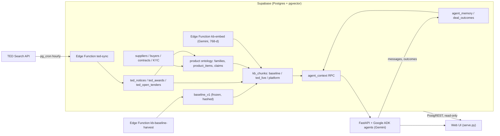

# SalesPatriot Agent

**Buyer and supplier AI agents that find, vet and negotiate Europe's weapons and ammunition supply deals,
grounded in EU public procurement data.** Built for the *Build the Arsenal: SalesPatriot Europe Challenge*
(Warsaw, 30 October 2026).

The system reads every tender on TED (Tenders Electronic Daily) in four product classes: ammunition, firearms,
parts of firearms and ammunition, and miscellaneous weapons. It covers supplies only, across all of Europe.
It turns ten years of procurement history into evidence an agent can cite, and gives each company an agent that
works inside a mandate. A supplier agent assesses a tender. A buyer agent finds proven suppliers, weighs their
KYC and 14 per-deal checks, and benchmarks their quotes against real awarded prices. We measured the effect:
with the historical layer, the agents' context covers **56% vs 45%** of the ground-truth facts, and **86% vs 29%**
for quote evaluation ([eval](evals/agent_context/results-2026-10-30.md)).

## Why it works

- **History is frozen; only the platform learns.** The knowledge base has three layers.
  `baseline_v1` holds 17,025 TED notices, linked into 10,222 procedures from tender to outcome. It is frozen
  with a SHA-256 content manifest, and guard triggers block any change to it.
  `ted_live` is synced every hour.
  `platform` holds our own deals and is the only layer that writes agent memory.
  Statistics are blended as `w = n_platform / (n_platform + 10)`: history is the prior, and each closed deal on
  the platform moves the estimate. Backtests stay reproducible, and every piece of evidence names its layer.
- **One context call per purpose, not free-form RAG.** Agents never query tables. They call
  `agent_context(role, purpose, subject)` with one of five purposes and get the same JSON shape back every time:
  facts, candidates, evidence, price anchors, regulatory profile, memory, priors and warnings.
  The logic lives in SQL, so the backend stays thin and every agent sees the same facts. In the eval the call
  took a median of 84 ms.
- **Every number has a ref and an n.** Each evidence item and price anchor has a `ref` (for example
  `ted:750233-2026`), and priors state their sample size. Unknown values stay unknown: null plus a warning,
  never zero and never a guess. Before a message is stored, the orchestrator drops any ref the agent cites that
  appears neither in its context pack nor in its tool results, and records it in `payload.dropped_refs`.
- **The model recommends; the mandate decides.** Gemini drafts and recommends. Python policy gates decide what
  happens. An `accept` above the autonomous limit becomes `escalate`. A price above the ceiling becomes a
  `counter` at the ceiling. Unknown KYC escalates. The agent's company id is bound in a closure by the backend,
  so the model never chooses whose data it reads.
- **Strict unit prices.** A price benchmark uses only clean data points: pieces, quantity above 1, a single lot
  with a stated quantity, and one result notice. It matches family, calibre and country, and never mixes
  calibres. The eval caught a "unit price" of 3.95 bn PLN per 155 mm round. With these rules it is gone, and
  suspect priors fell from 5 to 1 across 31 open-tender scopes.
- **One ontology for supply and demand.** TED tenders, awarded lots and supplier catalogue lines are classified
  into the same 28 product families when stored, not at query time, using CPV codes, calibre and keywords, so
  supply and demand are matched within one family. Embeddings come from one multilingual model
  (`gemini-embedding-001`, 768 dimensions), because TED notices are written in the EU's 24 official languages.
- **We evaluate the context, not the prose.** The eval scores 25 questions about real open tenders against
  ground truth computed in SQL. It is read-only and makes no LLM call. Each pack is compared with an exact
  replica that leaves out the history layer, which reproduced the real evidence in 34 of 34 packs.

## Architecture



## How it works

### 1. Data ingest
- [`supabase/functions/ted-sync/sync.ts`](supabase/functions/ted-sync/sync.ts) runs every hour at minute 17
  (pg_cron → Edge Function). It re-reads the last two days and upserts by publication number. As of
  30 October 2026 the public [status endpoint](https://aodxjmjnsqvadxcrepfr.supabase.co/functions/v1/ted-sync)
  reports 4,840 notices, 1,036 award rows (one per notice and winner) and 33 open tenders.
- Company profiles come from [`ted_company_profiles.py`](ted_company_profiles.py) and
  [`ted_supplier_contracts.py`](ted_supplier_contracts.py) (lot-level awards parsed from the eForms XML).
  [`translate_data.py`](translate_data.py) translates them to English and [`supabase_sync.py`](supabase_sync.py)
  pushes them to Supabase.
- Scope, filters and API limits: [`knowledge_base/21-focus-scope.md`](knowledge_base/21-focus-scope.md),
  [`20-ted-api-reference.md`](knowledge_base/20-ted-api-reference.md),
  [`25-supabase-ted-sync.md`](knowledge_base/25-supabase-ted-sync.md).

### 2. Product ontology
- [`data/families.yaml`](data/families.yaml) maps 4 CPV classes to 28 product families, plus 7 out-of-scope
  families for noise. It also defines attribute schemas, calibres and regulatory crosswalks (EU Military List,
  Firearms Directive, ADR). [`seed_product_taxonomy.py`](seed_product_taxonomy.py) seeds the `product_*` tables.
- Database triggers ([`product_bridge`](supabase/migrations/20261030134613_product_bridge.sql)) copy contracts,
  catalogues, notices and awards into `product_items` (3,977 items on 30 October 2026). A rules classifier
  ([`product_classifier_rules`](supabase/migrations/20261030140649_product_classifier_rules.sql)) runs every
  10 minutes. How trustworthy a source is and how its family was assigned are stored as separate fields.
- Docs: [25-product-families](knowledge_base/25-product-families.md),
  [26-product-classification-pipeline](knowledge_base/26-product-classification-pipeline.md),
  [27-ontology-integration-guide](knowledge_base/27-ontology-integration-guide.md).

### 3. Knowledge layers and embeddings
- [`kb-baseline-harvest`](supabase/functions/kb-baseline-harvest/harvest.ts) collected the history:
  315 TED requests, then linked each result notice to its tender by procedure id, previous-notice reference
  or buyer + CPV window: 10,222 procedures from October 2016 to October 2026, each with its outcome
  (awarded, cancelled, unsuccessful…). Statistics and 84 pattern cards are derived from them.
  [`kb_baseline_freeze`](supabase/migrations/20261030150601_kb_baseline_freeze.sql) writes the manifest and
  hash and then blocks every later write.
- [`kb_store`](supabase/migrations/20261030142503_kb_store.sql) defines `kb_chunks`, one card per tender,
  award, contract, profile, catalogue line, conversation or pattern. Search is hybrid: an HNSW vector index plus
  full text. On 30 October 2026 the store held 7,173 baseline, 859 live and 365 platform cards, all embedded by
  [`kb-embed`](supabase/functions/kb-embed/embed.ts) (every 5 minutes).
- A lot-level ingest from the eForms XML ([`ted_baseline_lots.py`](ted_baseline_lots.py),
  [`kb-baseline-lots`](supabase/functions/kb-baseline-lots/lots.ts)) builds the next snapshot next to v1.
  `baseline_v1` stays the active snapshot.
- Design: [`knowledge_base/23-self-learning-rag.md`](knowledge_base/23-self-learning-rag.md).

### 4. Agent context API
| Purpose | Used by | What the pack answers |
|---|---|---|
| `assess_tender` | supplier | What is being bought, can we prove we supplied it, what did it cost before, who is the buyer? |
| `find_suppliers` | buyer | Who has delivered this family and calibre, with KYC and due-diligence scores |
| `evaluate_quote` | buyer | Is this unit price inside the historical p25–p75 for the same family, calibre and country? |
| `check_counterparty` | both | Registers, sanctions, KYC checks and contract history of the other side |
| `search` | both | Hybrid retrieval over all cards |

SQL: [`agent_context`](supabase/migrations/20261030144853_agent_context.sql) and
[helpers](supabase/migrations/20261030144706_agent_context_helpers.sql), including priors and the blend.
The full contract and pack shape are in
[`docs/agent-context-rag-implementation.md`](docs/agent-context-rag-implementation.md).

### 5. Agents and backend
- [`app/backend/main.py`](app/backend/main.py) is the FastAPI app. The agents are Google ADK agents with typed
  outputs ([`agents/main.py`](app/backend/agents/main.py), [`agents/company.py`](app/backend/agents/company.py)).
- [`knowledge/client.py`](app/backend/knowledge/client.py) (`KnowledgeClient`) is a thin async layer over the
  RPCs. [`knowledge/tools.py`](app/backend/knowledge/tools.py) defines the five ADK tools: `get_context`,
  `search_knowledge`, `recall_memory`, `get_family_schema` and `regulatory_profile`.
  [`knowledge/embeddings.py`](app/backend/knowledge/embeddings.py) embeds queries.
- [`knowledge/conversations.py`](app/backend/knowledge/conversations.py) orchestrates persisted negotiations:
  introduction → policy gate → RFQ → quote → evaluate → accept, counter or escalate. Closing a conversation
  writes an episode to memory and refreshes its card in the platform layer.
  [`app/backend/live/`](app/backend/live/) runs the company-agent flow behind the live web demo.
- Flow and API: [`docs/agent-workflow.md`](docs/agent-workflow.md), [`docs/backend-api.md`](docs/backend-api.md).

### 6. Due diligence
- **KYC at onboarding** ([`supplier_due_diligence.py`](supplier_due_diligence.py),
  [`dd_sources.py`](dd_sources.py)) gives each supplier a score from 1 to 10. It weights six categories, and
  hard gates override the score: a sanctions match, Russian or Belarusian ownership, or insolvency. Checks
  K1–K11 draw on free sources: VIES, GLEIF, national registers (PL, CZ, FR, RO, SK, DK, EE, LV) and EU, UN,
  OFAC and UK sanctions lists. Thin evidence caps the score, so a thin file can never look excellent.
- **Per-deal checks D1–D14** ([`deal_due_diligence.py`](deal_due_diligence.py),
  [`deal_rules.py`](deal_rules.py)) cover the Military List and Firearms Directive category, licences for the
  flow, embargoes, an ITAR/EAR and classification-marking scan, ADR transport, price sanity, financial capacity,
  integrity and mandate fit. The result is GO, GO WITH CONDITIONS, ESCALATE or NO-GO, with evidence for each
  check. The output is in [`data/deals/`](data/deals/).
  Design: [`knowledge_base/22-kyc-and-deal-due-diligence.md`](knowledge_base/22-kyc-and-deal-due-diligence.md).

### 7. Web UI
[`web/`](web/) has no build step and is served by [`serve.py`](serve.py). Pages: overview, supplier and buyer
lists, one page per company, demo sign-in and an agent workspace for each company. Agent chats run as floating
windows. They are simulated negotiations on real tender and profile data. Quantities, mandates and peer
references in them are illustrative and labelled as such. Families, calibres and regulatory badges come from
the database views through [`web/ontology.js`](web/ontology.js).

## Results (30 October 2026, `baseline_v1`)

[`evals/agent_context/`](evals/agent_context/README.md): 25 questions across the five purposes, SQL ground
truth, read-only and re-runnable.

| Measure | With history | Without |
|---|---|---|
| Recall of ground-truth items in the context pack (25 questions, 142 items) | **56%** | 45% |
| `find_suppliers` recall | **50%** | 31% |
| `assess_tender` recall | **64%** | 58% |
| Quote evaluation recall (3 emulated questions) | **86%** | 29% |
| Nearest-neighbour precision@5, same product family (14 open tenders) | **0.46** | 0.24 |
The strict unit-price rules cut suspect priors from 5 to 1 across 31 open-tender scopes. Full per-question
breakdown: [`evals/agent_context/results-2026-10-30.md`](evals/agent_context/results-2026-10-30.md).

## Quick start

```bash
# Web UI (reads Supabase with the public, read-only key)
python3 serve.py                      # http://127.0.0.1:8765/

# Agent API (needs GOOGLE_API_KEY and DATABASE_URL in app/backend/.env)
uv sync --project app/backend --extra dev
uv run --project app/backend uvicorn app.backend.main:app --host 127.0.0.1 --port 8000
uv run --project app/backend python -m pytest app/backend/tests

./demo_reset.sh                       # both together, with a clean demo state
# One deal check from the command line
python3 deal_due_diligence.py --tender 671826-2026 --supplier supplier-ita-n0057381f \
  --offer '{"total_value":128000,"delivery_date":"2027-04-30","incoterms":"DAP"}'
```

Setup and Gemini quotas: [`docs/local-development.md`](docs/local-development.md). Cloud Run deployment of the
web UI and agent API: [`docs/deploy-cloud-run.md`](docs/deploy-cloud-run.md).

## Repo map

| Path | What |
|---|---|
| [`app/backend/`](app/backend/) | FastAPI + Google ADK agents, knowledge client, tools, conversation orchestrator, tests |
| [`web/`](web/), [`serve.py`](serve.py) | Web UI and its server (clean URLs, `/api/offers`, proxy to the agent API) |
| [`supabase/functions/`](supabase/functions/) | Edge Functions `ted-sync`, `kb-embed`, `kb-baseline-harvest`, `kb-baseline-lots` |
| [`supabase/migrations/`](supabase/migrations/) | Schema, ontology, knowledge store, `agent_context`, memory, snapshot freeze |
| [`evals/agent_context/`](evals/agent_context/) | Context-pack evaluation and results |
| [`knowledge_base/`](knowledge_base/README.md) | Team knowledge base: challenge, pain points, data sources, TED API, ontology, agent design |
| [`docs/`](docs/README.md) | Backend architecture, API reference, local setup, deployment |
| [`deploy/`](deploy/) | Dockerfiles and Cloud Build config for both services |
| [`data/`](data/) | Taxonomy, CPV reference data, company profiles, deal checks, sample notices |
| `ted_*.py` | TED export, profiles, supplier contracts, notice samples, lot-level XML |
| `supplier_due_diligence.py`, `dd_sources.py`, `deal_due_diligence.py`, `deal_rules.py` | KYC score and per-deal checks |
| `seed_product_taxonomy.py`, `translate_data.py`, `supabase_sync.py`, `fetch_logos.py` | Taxonomy seed, translation, Supabase push, logos |

## Data and compliance

The system uses only public data. Procurement data comes from TED. Company facts come from free open sources:
national registers, VIES, GLEIF, Wikidata, the EU Funding & Tenders portal, GDELT and public sanctions lists.
By design no ITAR/EAR-controlled, classified or CUI content and no customer data enter the platform. Check D4
scans each tender for ITAR/EAR designations and classification markings and escalates when it finds them.
The browser uses only the publishable key, which row-level security keeps read-only on the TED, company and
ontology tables. Secrets live in Supabase (Vault, Edge Function secrets) and Google Secret Manager, never in git.
