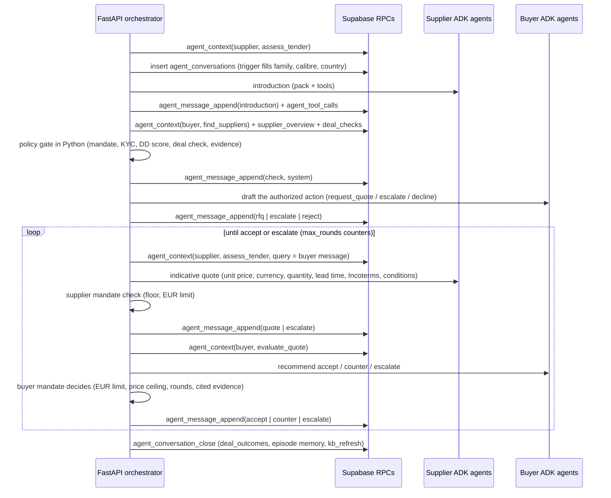
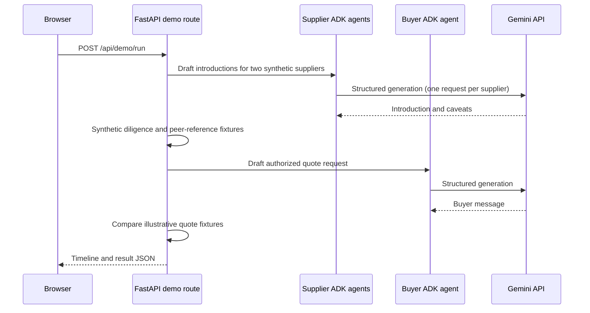

# Agent workflow and architecture

## Purpose and roles

SalesPatriot models two distinct business roles:

- **Supplier agents** prepare non-binding introductions using supplier profile
  information and a demand notice.
- **Buyer agents** draft communications constrained by buyer-approved policy
  and a decision supplied by the backend caller.

The backend is the policy and orchestration boundary. A model drafts text; it
does not independently authorize procurement actions, perform legal due
diligence, make an award, or send messages to another organization.

## What is implemented now

The current backend is a local FastAPI and Google ADK foundation:

1. At startup, it reads `buyers.json` and `suppliers.json` from
   `data/profiles/` and keeps the validated records in memory.
2. A caller submits a supplier preview or buyer draft request to FastAPI, or
   asks one loaded buyer profile agent to request a reference from another.
3. FastAPI checks the requested profile's opt-in or buyer policy gate for
   preview/draft calls. A peer reference call is limited to public TED fields.
4. Preview/draft calls create an ADK agent with a role-specific instruction and
   typed output schema, then invoke Gemini through an ADK `Runner`.
5. ADK uses an in-memory session for that invocation. The backend validates the
   final structured response and returns it to the caller.

The profile IDs and profile data are not stored in PostgreSQL by this backend.
The preview routes above do not use Supabase.

### Context, RAG, memory and persisted conversations (WS5)

`app/backend/knowledge/` implements WS5 of
[agent-context-rag-implementation.md](./agent-context-rag-implementation.md):

- `client.py`: `KnowledgeClient`, a thin async layer over the Supabase RPCs
  (`agent_context`, `kb_search`, `memory_recall`, `memory_write`,
  `memory_feedback`, `agent_message_append`, `agent_conversation_close`) and a
  few reads (`product_family_schema`, `ui_regulatory_profile`,
  `supplier_overview`, `ted_open_tenders`, `agent_mandates`, `deal_checks`).
  Logic stays in SQL.
- `embeddings.py`: query embeddings (`gemini-embedding-001`, 768 dimensions,
  `RETRIEVAL_QUERY`, L2-normalised, 3 s timeout, LRU cache). A failure returns
  no vector, and the RPCs fall back to full text.
- `tools.py`: ADK function tools `get_context`, `search_knowledge`,
  `recall_memory`, `get_family_schema` and `regulatory_profile`. The viewer id,
  role and conversation are bound in a closure by the backend, never chosen by
  the model. A supplier agent's `assess_tender` always uses its own id, and
  `evaluate_quote` only reads the agent's own conversation.
- `conversations.py`: the orchestrator of persisted conversations.
- `routes.py`: the HTTP routes ([backend-api.md](./backend-api.md)).
- `load_kb_docs.py`: loads `knowledge_base/*.md` into `kb_chunks`.

**How agents get context: tools plus a pre-fetched pack.** The installed ADK
(1.39.1) supports `tools` together with `output_schema`: on the Gemini Developer
API it exposes a `set_model_response` tool and enforces the schema on the final
answer. The agents in a conversation therefore get the five knowledge tools and
keep their typed outputs. In addition, the orchestrator calls `agent_context`
for each step itself, because the Python policy gates need the pack, and passes
it to the agent as `context_pack` in the payload. The agent cites refs from the
pack and calls tools only for follow-up lookups. The instruction line is
"Before answering, call get_context with the right purpose unless the payload
already contains a context_pack for it; cite refs; treat unknown values as
unknown." Refs that appear neither in the pack nor in the turn's tool results
are dropped before a message is stored, and listed in `payload.dropped_refs`.
The preview routes keep their tool-free agents: there the caller supplies the
decision and evidence.

**A persisted conversation** (`POST /v1/conversations` with `run: "full"`, or
`POST /api/demo/run-live`):

The model recommends and the Python mandate decides: an `accept` above the
autonomous limit becomes `escalate`; an `accept` above the price ceiling becomes
a `counter` at the ceiling while rounds remain; a counter that is not below the
quote, or a counter after `max_rounds`, becomes `escalate`. Totals in a currency
other than EUR cannot be checked against the EUR limit without an FX rate, so
they escalate. Unknown KYC status or due-diligence score escalates at the gate.
Mandates come from the request, else from an active `agent_mandates` row
(`company_id` = supplier id, buyer id or `buyer:<buyer name>`), else the default
platform policy of `deal_due_diligence.py`. The mandate used is stored on the
conversation, and every message carries `mandate_source`.

Every message goes through `agent_message_append`, which assigns `seq` and
enforces the state machine. Every context fetch (`tool = 'agent_context'`,
`args.prefetch = true`) and every agent tool call is logged in `agent_tool_calls`
with the message it informed. An agent failure is stored as a system `escalate`
message, and the route returns `502` with the conversation id. Only `accept`
closes a conversation automatically; escalated conversations wait for a human.
`POST /v1/conversations/{id}/outcome` closes any conversation and records
delivery and quality.

Supabase status on 2026-10-30 (checked read-only): `kb_chunks`, `kb_search`,
`kb_refresh`, the conversation and memory tables and RPCs are deployed.
`agent_context` (WS3) is not deployed yet: until it is, `/v1/context`,
conversations and `run-live` return `503` ("agent_context is not available in the
database yet"). `/v1/knowledge/search`, `/v1/memory*`, `GET /v1/conversations/{id}`
and `/outcome` work against the live RPCs. They were exercised with SQL in
rolled-back transactions, not yet through the running backend.

## Current interaction boundary

Agent interactions are mediated by this backend. It creates an in-process
`BuyerProfileAgent` for each loaded buyer profile. One such agent can send a
typed reference request to another through the backend's buyer-agent directory;
the receiving agent returns only allowlisted public TED evidence from its own
buyer profile. This path is deterministic and does not call Gemini.

These are platform-hosted agents backed by profile data, not agents operated by
the named public authorities. There is no remote A2A transport, agent-card
exchange, external buyer endpoint, or cross-organization message delivery.
The profile-backed exchange is a truthful local representation of what the
loaded public data contains; it is not a statement or endorsement from the
buyer organization.

## Profile-backed peer reference

The browser demo provides a separate reference-check flow based on
`data/profiles/`:

1. The requesting buyer agent selects a supplier and a different buyer agent
   whose buyer profile lists that supplier as a counterpart.
2. The requester sends an in-process message scoped to public TED profile
   evidence.
3. The peer agent reads only matching `top_counterparts` and
   `recent_notices` fields from its own profile.
4. The response identifies the public relationship and notice references, if
   present, and explicitly reports that delivery/quality performance is not
   available when the profile has no such data.

The exchange cannot disclose KYC, due-diligence notes, internal communications,
or other non-allowlisted profile fields. It is not persisted and makes no
external message. In the current profile set, exact supplier-counterpart
matches include PANNA PLUS with Slovenia's Ministry of Defence and Baltic Fox
OÜ with Lithuania's Resource Agency under the Ministry of the Interior.

The `/demo` page runs a synthetic workflow centrally:

In the demo, the peer-buyer response is a seeded fixture, checks are synthetic,
and quote comparison uses deterministic values. No real buyer or supplier is
contacted, no offer is made, no bid is submitted, and the run is not persisted.
The normal successful demo makes three Gemini API calls.

## Intended workflow (not yet implemented)

The persisted conversation above covers steps 3, 5 (policy gate only) and 7 for
one tender and one supplier at a time, on request. The longer-term workflow
discussed for the product is event-driven:

1. Ingest a new TED contract notice.
2. Match its CPV categories against suppliers that explicitly opted in.
3. Ask eligible supplier agents to assess declared capacity and draft
   non-binding introductions.
4. Route permitted information to the buyer's agent.
5. Evaluate the buyer-specific diligence policy and, where allowed, request
   attributable supplier references from relevant peer-buyer agents. The local
   profile-backed public-evidence exchange exists, but authenticated remote
   buyer-agent communication does not.
6. Treat missing or conflicting reference evidence as unknown or escalated,
   not as an automatic pass.
7. Only after the buyer's policy permits it, request indicative supplier
   quotes, compare them, and leave any award decision to an authorized human.

Not present in the backend: triggering conversations from notice ingestion,
durable event processing (turns run in process, inside the HTTP request), real
peer-agent communication and reference permissions, running D1–D14 (the gate
reads the latest stored `deal_checks` row when there is one), message delivery
to real companies, and authentication. They must not be inferred from the demo
timelines.

## Agent contracts and safety boundaries

Supplier outputs use `SupplierIntroductionDraft`:

- `non_binding_message`
- `caveats`

The supplier instruction forbids invented capacity, licenses, certifications,
or performance and forbids prices, delivery promises, acceptance of terms, and
claims that a bid was submitted. Capacity declarations are prompt context, not
an independently verified inventory system.

Buyer outputs use `BuyerMessageDraft`:

- `action`: `request_quote`, `request_clarification`, `decline`, or `escalate`
- `message`

Both outputs also have `refs` (default empty), the knowledge refs the agent cites.
Persisted conversations add two typed outputs. `SupplierQuoteDraft` is an
indicative, non-binding quote: unit price, currency, quantity and unit, whether
the quantity is indicative, lead time, Incoterms, validity, conditions, caveats
and refs. `BuyerQuoteEvaluation` is a recommendation (`accept`, `counter` or
`escalate`), with a message, a counter unit price, a rationale and refs. Price
anchors may come only from the same product family and calibre, and award notice
totals are upper bounds, never unit prices.

The buyer instruction constrains drafting to an action and evidence context
provided by the caller. The API checks that the buyer policy is active and that
the requested action is permitted. It does not itself execute arbitrary checks
listed in `agent_policy.checks`; the caller currently supplies the decision and
evidence summary.

Gemini receives a JSON Schema for structured output. The schema omits
`additionalProperties` because the Gemini Developer API rejects that field in
this request path. Pydantic still rejects extra fields when validating the
model's response locally.

## State and persistence

- Buyer and supplier profiles are loaded from JSON at process startup; restart
  the backend to reload them.
- ADK sessions are in-memory and created per invocation (one per agent turn).
- Persisted conversations live in Supabase: `agent_conversations`,
  `agent_messages`, `agent_tool_calls`, `deal_outcomes`, and the episode in
  `agent_memory` written when a conversation closes. The preview routes and
  `/api/demo/run` persist nothing.
- The database engine is optional until `DATABASE_URL` is configured. Without
  it, the readiness probe and every knowledge and conversation route return `503`.
