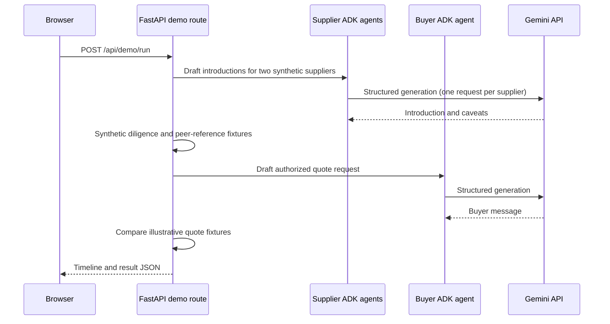

# Agent workflow and architecture

## Purpose and roles

SalesPatriot models two distinct business roles:

- **Supplier agents** prepare non-binding introductions using supplier profile
  information and a demand notice.
- **Buyer agents** draft communications constrained by buyer-approved policy
  and a decision supplied by the backend caller.

The backend is the policy and orchestration boundary. A model drafts text; it
does not independently authorize procurement actions, perform legal due
diligence, make an award, or send messages to another organization.

## What is implemented now

The current backend is a local FastAPI and Google ADK foundation:

1. At startup, it reads `buyers.json` and `suppliers.json` from
   `data/profiles/` and keeps the validated records in memory.
2. A caller submits a supplier preview or buyer draft request to FastAPI.
3. FastAPI checks the requested profile's opt-in or buyer policy gate.
4. The backend creates an ADK agent with a role-specific instruction and typed
   output schema, then invokes Gemini through an ADK `Runner`.
5. ADK uses an in-memory session for that invocation. The backend validates the
   final structured response and returns it to the caller.

The profile IDs and profile data are not stored in PostgreSQL by this backend.
Supabase is currently used only by the optional readiness probe, which runs
`SELECT 1`.

## Current interaction boundary

Agent interactions are currently mediated by this backend. The supplier
preview route invokes a supplier agent and returns its draft; the buyer draft
route invokes a buyer agent and returns its draft. There is no remote
agent-to-agent transport, buyer-agent directory, agent card exchange, or
cross-organization message delivery yet.

The `/demo` page runs a synthetic workflow centrally:

In the demo, the peer-buyer response is a seeded fixture, checks are synthetic,
and quote comparison uses deterministic values. No real buyer or supplier is
contacted, no offer is made, no bid is submitted, and the run is not persisted.
The normal successful demo makes three Gemini API calls.

## Intended workflow (not yet implemented)

The longer-term workflow discussed for the product is event-driven:

1. Ingest a new TED contract notice.
2. Match its CPV categories against suppliers that explicitly opted in.
3. Ask eligible supplier agents to assess declared capacity and draft
   non-binding introductions.
4. Route permitted information to the buyer's agent.
5. Evaluate the buyer-specific diligence policy and, where allowed, request
   attributable supplier references from relevant peer-buyer agents.
6. Treat missing or conflicting reference evidence as unknown or escalated,
   not as an automatic pass.
7. Only after the buyer's policy permits it, request indicative supplier
   quotes, compare them, and leave any award decision to an authorized human.

Notice ingestion, durable event processing, real peer-agent communication,
reference permissions, due-diligence execution, supplier quote collection, and
quote persistence are not present in the current backend. They must not be
inferred from the synthetic demo timeline.

## Agent contracts and safety boundaries

Supplier outputs use `SupplierIntroductionDraft`:

- `non_binding_message`
- `caveats`

The supplier instruction forbids invented capacity, licenses, certifications,
or performance and forbids prices, delivery promises, acceptance of terms, and
claims that a bid was submitted. Capacity declarations are prompt context, not
an independently verified inventory system.

Buyer outputs use `BuyerMessageDraft`:

- `action`: `request_quote`, `request_clarification`, `decline`, or `escalate`
- `message`

The buyer instruction constrains drafting to an action and evidence context
provided by the caller. The API checks that the buyer policy is active and that
the requested action is permitted. It does not itself execute arbitrary checks
listed in `agent_policy.checks`; the caller currently supplies the decision and
evidence summary.

Gemini receives a JSON Schema for structured output. The schema omits
`additionalProperties` because the Gemini Developer API rejects that field in
this request path. Pydantic still rejects extra fields when validating the
model's response locally.

## State and persistence

- Buyer and supplier profiles are loaded from JSON at process startup; restart
  the backend to reload them.
- ADK sessions are in-memory and created per invocation.
- Conversations, notice events, references, decisions, and quotes are not
  persisted.
- The database engine is optional until `DATABASE_URL` is configured. Current
  database use is a read-only connectivity check.
